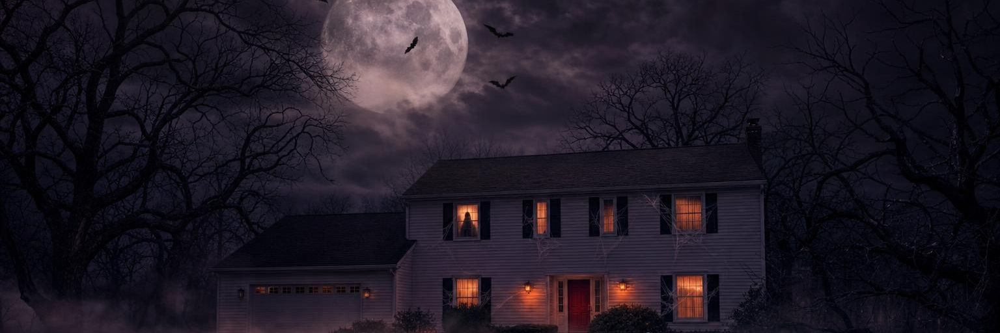
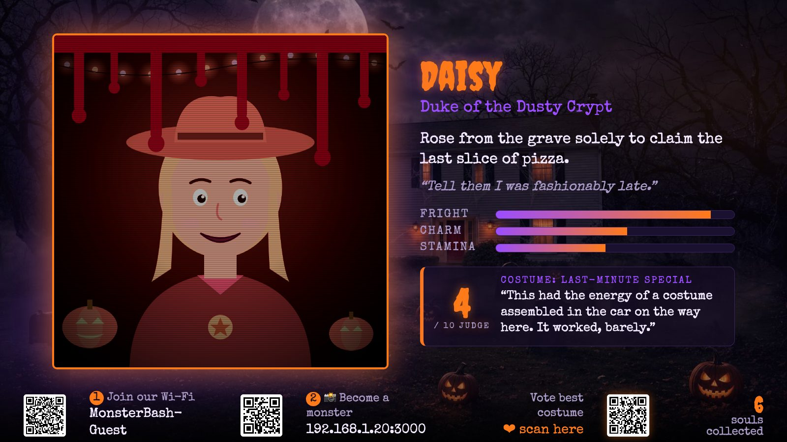
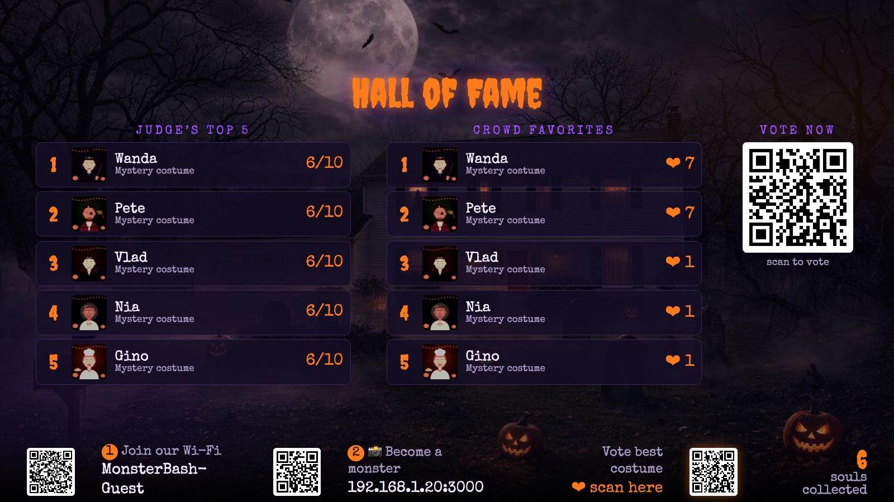
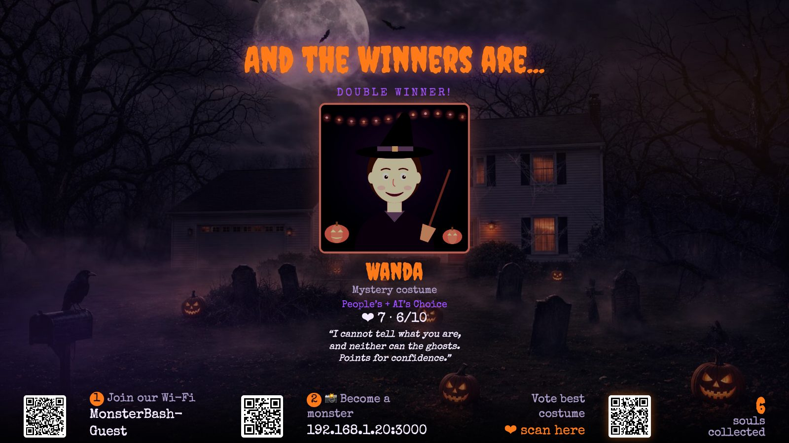
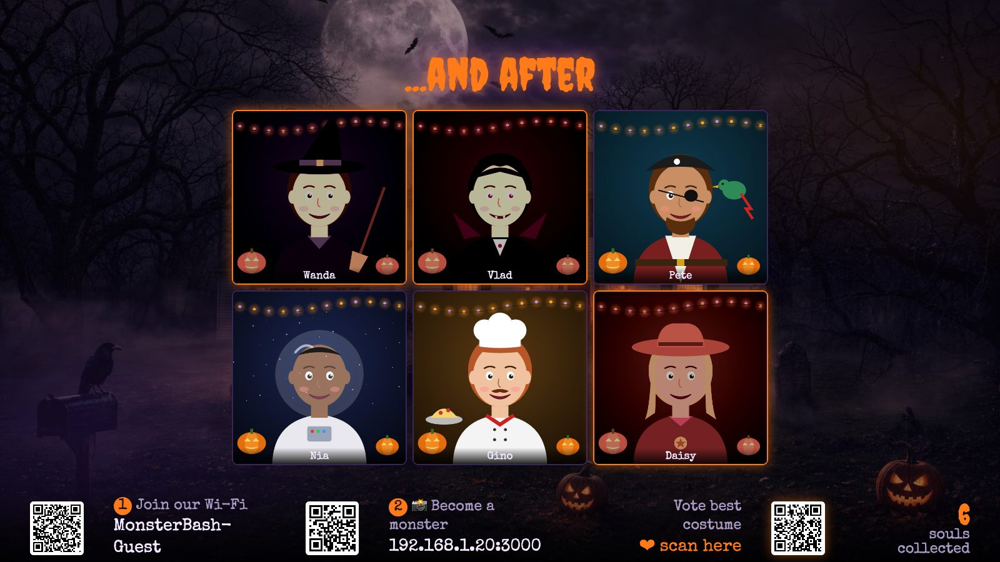
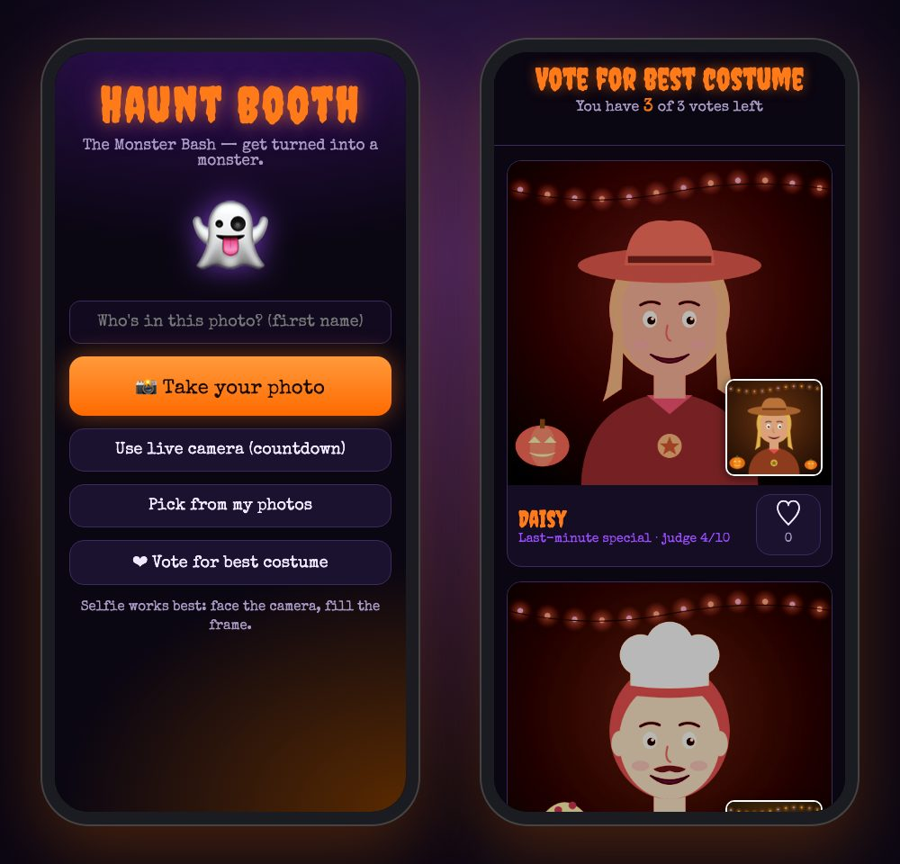
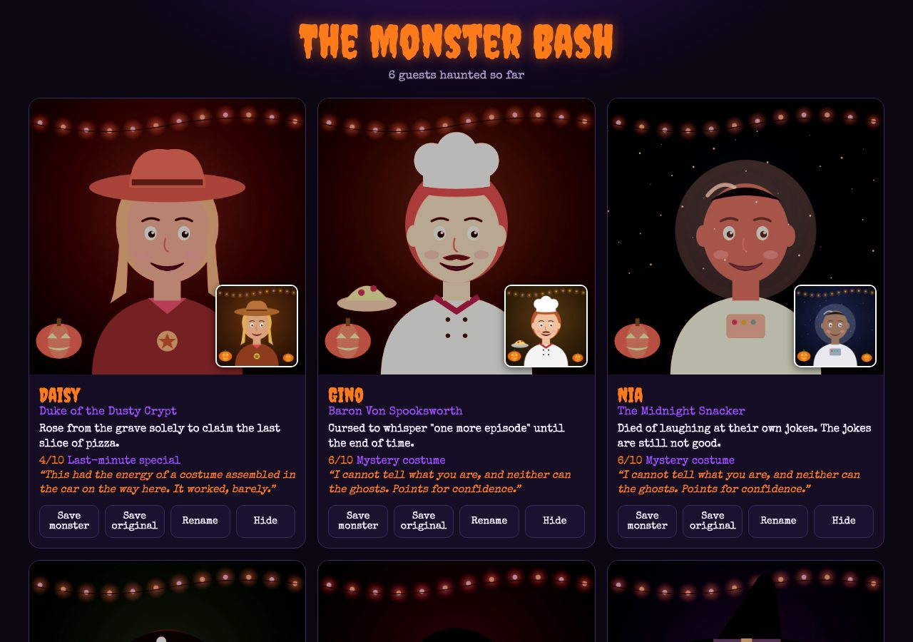

<p align="center">
  
</p>

<h1 align="center">🎃 Haunt Booth</h1>

<p align="center">
  <b>A Halloween party photo booth that turns your guests into monsters.</b><br>
  Guests snap a selfie on their phone → AI transforms them into a ghoul with a cursed trading card →
  a savage costume judge roasts their outfit → the TV runs the show all night.
</p>

<p align="center">
  
  
  
  
</p>

---

<p align="center">
  
  <br><sub>The TV: every guest gets a cursed trading card, stats and a roast from the AI costume judge.</sub>
</p>

> Screenshots run in **demo mode** with made-up cartoon guests. With an OpenAI key, each card shows a full AI monster portrait instead of the spooky filter.

## ✨ What it does

| | |
|---|---|
| 📸 **Phone booth** | Guests scan a QR code, type their name and take a selfie. No app to install. |
| 🧟 **AI monster makeover** | `gpt-image-1` turns each guest into a zombie, vampire, witch, possessed doll... in one of 10 rotating art styles (1930s horror film, VHS poster, gothic oil painting, Día de Muertos, stop-motion...). A vision model looks at their costume first and writes a one-of-a-kind transformation around it. |
| 🃏 **Cursed trading card** | A monster title, a cause of death, last words and Fright / Charm / Stamina stats. |
| ⚖️ **Costume judge** | A vision model guesses the costume, roasts it (never the person) and scores it out of 10. Optionally web-searches obscure costumes first. |
| ❤️ **Crowd vote** | Every phone gets 3 hearts. Voting closes on a timer, and the TV announces **People's Choice** and **AI's Choice**. If the AI finalists tie, it compares them side by side and picks one. |
| 🏚️ **Group scenes** | Every 15 guests, all their monsters get painted together throwing a party in front of your house. |
| 📺 **The TV show** | Cards rotate with a glitchy "possession" reveal, plus a Hall of Fame, a before/after montage and the winners. |
| 🎭 **Host easter egg** | The hosts don't become monsters: they become the most beautiful people in the room. |
| 🖨️ **Printable signs** | QR signs to join the Wi-Fi, get monsterized and vote. |

<table>
  <tr>
    <td width="50%"><br><sub><b>Hall of Fame:</b> the judge's top 5 and crowd favorites</sub></td>
    <td width="50%"><br><sub><b>And the winners are...</b> People's Choice + AI's Choice</sub></td>
  </tr>
  <tr>
    <td width="50%"><br><sub><b>Before / after montage:</b> every guest morphs into their monster</sub></td>
    <td width="50%"><br><sub><b>On guests' phones:</b> the booth and the vote page</sub></td>
  </tr>
</table>

<p align="center">
  <br>
  <sub><b>The album:</b> every result, downloadable, with host controls to rename or hide</sub>
</p>

## 🚀 Quick start

You need a Mac (or any computer) with [Node.js 18+](https://nodejs.org) and an [OpenAI API key](https://platform.openai.com/api-keys). There are no npm packages to install.

```bash
git clone https://github.com/omeirhaeghe/haunt-booth.git
cd haunt-booth
./install.sh        # checks Node, then runs the setup wizard
npm start           # or double-click start.command on a Mac
```

The setup wizard asks for your party name, address or tagline, API key, host names, when voting closes and your Wi-Fi details, then writes `.env`. Run `npm run setup` again any time to change them.

```
  🎃  HAUNT BOOTH SETUP
  Party name (shown on the TV) [Halloween Party]
  > The Monster Bash
  Subtitle: address, town or date (optional)
  > 13 Elm Street · Oct 31
  ...
  ✓ Saved settings to .env
```

**No API key?** Leave it empty: it runs in demo mode with a spooky filter instead of AI, so you can rehearse the whole flow (`npm run demo` forces it).

### On party night

1. Open **`http://localhost:3000/tv`** on the computer, press **F** for fullscreen and send it to the TV (HDMI, or AirPlay → *Use As Separate Display*).
2. Print the QR signs from **`http://localhost:3000/print`**.
3. Guests on the same Wi-Fi scan the code and start haunting.

Tip: run `caffeinate -d -i` so the Mac stays awake, and turn on Do Not Disturb.

## 🗺️ Pages

| URL | Who | What |
|---|---|---|
| `/` | Guests (phone) | Take a photo and get monsterized |
| `/vote` | Guests (phone) | 3 hearts for the best costumes |
| `/tv` | The TV | The show. `/tv#board`, `#winners`, `#montage`, `#scene` jump straight to a screen |
| `/album` | Everyone | All results and downloads. Rename / Hide only work from `localhost` |
| `/roam` | Host's phone | A roaming photographer mode: big shutter button, background uploads |
| `/print` | Host | Printable QR signs, 2 per sheet, with an ink-saver toggle |

**TV keys:** `F` fullscreen · `B` Hall of Fame · `A` before/after montage · `S` group scene · `W` winners (live preview while voting is open) · `C` close voting now

## ⚙️ Configuration

Everything lives in `.env` (the wizard writes the common ones). See [`.env.example`](.env.example) for the full list.

| Setting | Default | |
|---|---|---|
| `PARTY_TITLE` / `PARTY_SUB` | `Halloween Party` | Shown on the TV and booth |
| `VIP_NAMES` | none | Host first names, comma separated: they get glamour portraits |
| `VOTE_CLOSE` / `VOTE_LIMIT` | `23:00` / `3` | When voting closes (`off` = never) and hearts per phone |
| `IMAGE_QUALITY` | `medium` | `low` is faster and cheaper, `high` is scarier |
| `BACKGROUND` | `bg.jpg` | TV background, also the house in group scenes. Drop a spooky photo of *your* house in `public/` |
| `JUDGE_SEARCH` | off | `1` = the judge web-searches the costume first |
| `SCENE` | on | `0` turns off the group party paintings |
| `WIFI_NAME` / `WIFI_PASSWORD` | none | Adds a "join the Wi-Fi" QR code to the TV and signs (never leaves your computer) |
| `PUBLIC_URL` | LAN address | Set this if guests connect through a tunnel like ngrok |

**Personal touches:** copy [`guest-hints.example.json`](guest-hints.example.json) to `guest-hints.json` and add a fun fact per guest ("is a beekeeper", "runs marathons"). It gets worked into their monster and card. You can edit it mid-party.

## 💸 Cost

Roughly **$0.05 to $0.20 per guest** with `gpt-image-1` at medium quality (image edit, card, judge), plus about $0.25 per group scene. A 40-person party costs a few dollars. Use `IMAGE_QUALITY=low` to cut it further.

## 🔒 Privacy

Everything runs on your computer. Photos go only to the OpenAI API for processing and are saved to `album/` locally, which is git-ignored. Host controls only work from the machine itself. The judge and card prompts tell the AI to roast costumes, never people's looks, body or identity, and to keep everything PG.

## 🧱 How it's built

- **One file of Node** ([`server.js`](server.js)) using only the standard library: no framework and no `npm install`. It runs the HTTP server, the job queue (4 guests in parallel), OpenAI calls with retries and safety fallbacks, voting and awards.
- **Plain HTML pages** in [`public/`](public): no build step, no bundler.
- Data is plain JSON next to the images in `album/`, so it survives restarts.
- QR codes come from a bundled copy of [qrcode-generator](https://github.com/kazuhikoarase/qrcode-generator) (MIT), so they work offline.

## 🛣️ Roadmap

- [ ] A proper app: a one-click desktop app with the setup screen built in
- [ ] Custom party themes beyond Halloween (birthdays, Christmas, sci-fi, '80s prom...) with their own monsters, styles and wording
- [ ] Web-based setup page instead of the terminal wizard
- [ ] Shareable per-guest card page and a printable card

## 📄 License

[MIT](LICENSE). Made for one very haunted house party. 👻
